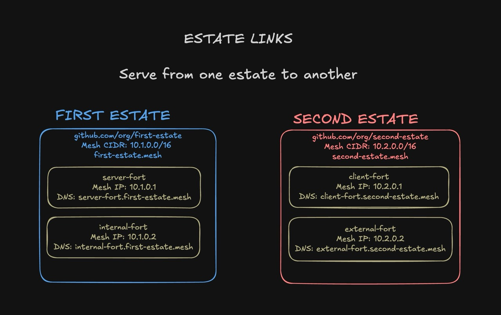
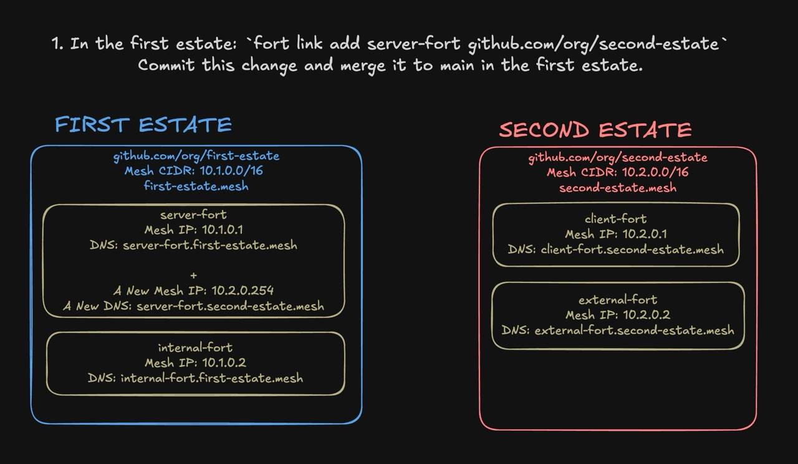
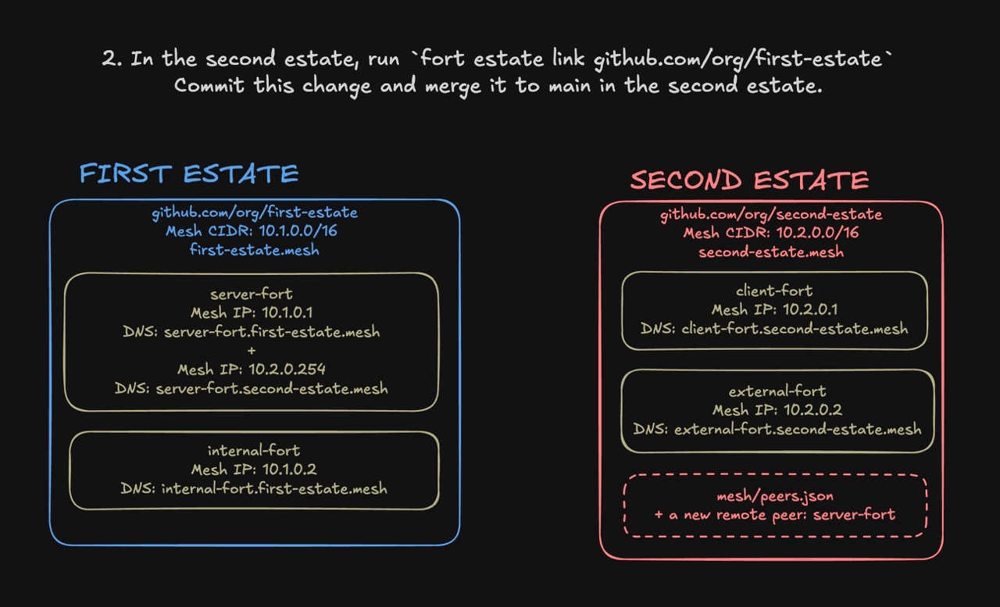
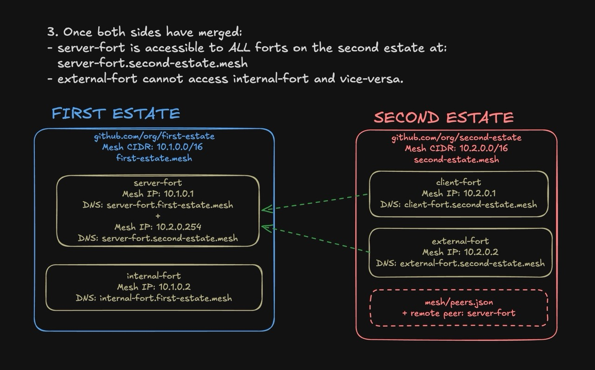

# Estate Links: Connectivity and Network Segmentation

While working on forts we came to the realization that _the estate makes for a nice network boundary_. Instead of defining a multi-dimension mesh in one repository, split forts by their area of concern and **Link** forts to other estates as necessary.

## Example: Production Monitoring and Incident Response

<p align="center">
  
</p>

Picture this: you've got a production estate, but want to collect observability data in a centralized place. You also might want to have services that interact with that observability data, but not have access to the production forts:

```
# infra estate:
- monitoring-fort
- incident-response-bot

# production estate:
- production-one
- production-two
...
```

### Step One:

<p align="center">
  
</p>

 In the infra estate, run `fort link add monitoring-fort https://path/to/production`. This stages a declarative intent and generates a new wireguard keypair for the production mesh.

```
# nixos/hosts/monitoring-fort/default.nix
sfi.links.production = {
  repo = "ssh://git@github.com/sfi/production.git";
  interface = "wg-prod";
  zone = "production.mesh";
  port = 51820;
  address = "10.1.0.254";
};
```

### Step Two:

<p align="center">
  
</p>

In the production estate, run `fort estate link https://path/to/infra`. This command reads the declarative intent from the infra estate and _adds the linked forts to the mesh_ as **remote peers**.

```
{
  "peers": {},
  "clients": {},
  "remotes": {
    "monitoring-central": {
      "wg_vpn_ip": "10.1.0.254",
      "wg_endpoint_ip": "monitoring-central.streetfortress.cloud",
      "wg_endpoint_port": 51821,
      "public_key": "VW7lUO8+F0VNUGUMA+8jPC4INoKKIBTAENZg6nVQqmg="
    }
  }
}
```

### The Result

<p align="center">
  
</p>

Once both sides have merged their respective configurations,  the metric collector endpoint `monitoring-central.production.mesh` is available to **all forts on the production mesh**. `incident-response-bot` has no direct access to production. Instead, that bot reads observability signals from `monitoring-central.`_infra_`.mesh` and proposed remediations _as Pull Requests!_ Due to the declarative nature of forts, this approach is surprisingly effective.

A working pair of linked estates is published in the examples repo: the [`link-side-a`](https://github.com/streetfortress/estate-examples/tree/link-side-a) and [`link-side-b`](https://github.com/streetfortress/estate-examples/tree/link-side-b) branches hold the two halves, with the handshake's rendered result committed and annotated. Each branch's README walks through making it your own.

## Fort Federation and meshing with other people's estates

Initially we intended for forts to be used internally as a platform tool. But with the git repository and linking semantics, it's feasible to _link a fort to someone else's estate_. This opens up interesting possibilities for federation: cross-forge pull requests in forgejo, social networks, and more. 

**Only peer with those you trust** and please act responsibly.

### Public Estates

All secrets are _encrypted at rest_ in the estate repository using **sops**. However, there are still concerns with hosting a public estate:
- So-called **Collect now, Decrypt Later** attacks. Exposing cypher-text publicly is inviting trouble. Strong keys and post-quantum encryption algorithms help assuage the concern but it's still real.
- The mesh topology is exposed: An estate describes _everything_ about the environment, so anyone can read the mesh IPs, workload configurations, etc.

Using **ssh** for git authentication and or using **private estate repositories** is recommended for serious use cases.

