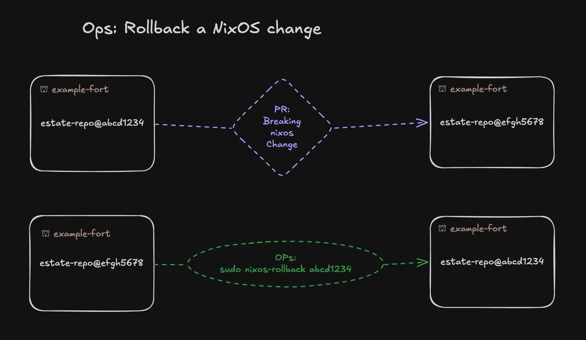
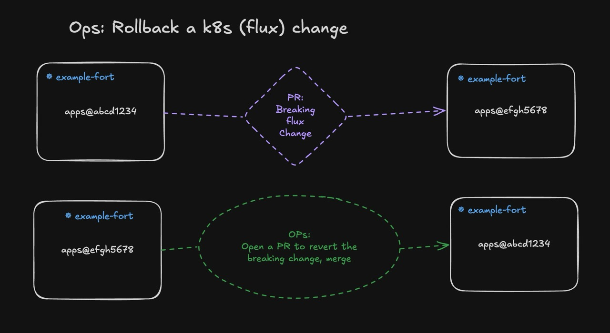

  

# Fort Ops - An Operational Primer

Forts was designed around a few strong operational practices - lessons from years of operating enterprise cloud and hyperscaler environments. They may not be what you're used to, so the core precepts are laid out below.

More specific documentation can be found in [the reference docs](reference/ops.md) or the codebase comments (AI Generated).

**Contents**

- [Forts are 'Cattle' Machines](#forts-are-cattle-machines)
- [Least Privilege Rules Apply](#least-privilege-rules-apply)
- [Ops is about Recovery - Not Repairs](#ops-is-about-recovery---not-repairs)
  - [Commit SHAs: The "version" of config sets](#commit-shas-the-version-of-config-sets)
  - [Rolling back a change in `nixos/`](#rolling-back-a-change-in-nixos)
  - [Rolling back a change in `flux/`](#rolling-back-a-change-in-flux)
- [A Minimal, Declared, Network Surface](#a-minimal-declared-network-surface)
  - [There is no public facing "front door" on a fort](#there-is-no-public-facing-front-door-on-a-fort)
  - [Leverage the Estate mesh for fort-to-fort communication](#leverage-the-estate-mesh-for-fort-to-fort-communication)
- [Secrets in an Estate](#secrets-in-an-estate)
  - [Rotating Secrets](#rotating-secrets)

## Forts are 'Cattle' Machines

Think of a fort as an ephemeral compute resource. It runs a declared configuration that you generate, identically, across estates. A fort's lifecycle is automation-friendly and consists of clearly encapsulated CLI actions, so you can spin them up and tear them down _very quickly_. The longest part of a fort deployment is the image build and upload steps, **not setting up boilerplate**.

## Least Privilege Rules Apply

There is _no_ public login path, _no_ normal privilege escalation to root, _no_ ability to imperatively make changes (read only kubeconfig).

In an estate, _All_ changes to the system go through source control and code review. This enables a few interesting techniques:
  - The entire configuration state of a deployment is captured in the git log.
  - Each configuration is a reference that can be reverted, cherry-picked, scripted as a drill, performance tested, and more.
  - Triage can live in the codebase as comments, documentation remains close to the code, not scattered across wikis etc.
  - A purely declarative infrastructure is easily understood by agents and can be extended with purpose-built monitoring, utility scripts, and runbook automation.

However, because _All_ changes must go through git, your abilities as an operator are rather limited. More on this below.

---

## Ops is about Recovery - Not Repairs

Forts is centered around NixOS and FluxCD: two systems that _continuously_ attempt to apply the declared state. If you try to change something manually, the forts machinery will _fight you_, automatically un-doing your changes. Therefore if something goes wrong, your first and usually best/quickest option to resume service is to _roll back to a known good config_. Recovering the service first allows operators to defer triaging and root-causing until an opportune time (ideally within a day or two - not at 3 am on a random Sunday).

### Commit SHAs: The "version" of config sets

The forts machinery uses **git commits** in the estate repo to "version" configurations. Estate commit `abcd1234` describes _everything_ about that environment at that point in time - nixos, flux workloads. If the next commit `efgh5678` breaks something, your ops goal is usually to get the system back to `abcd1234` (Some application changes, like database schema migrations, can complicate this process. Test accordingly before changing an important environment).

### Rolling back a change in `nixos/`

  

> NixOS keeps its history on disk. Generations are complete past states sitting locally, so nixos-rollback can choose one offline, with no source repo, no network, no build. 

It's possible for a nixos/ change to **sever the mesh**, and the way back from that situation is: out-of-band console access + `sudo nixos-rollback` (the menu lists each generation and the commit it was built from; pick the good one — mesh restored), then revert / fix main and `sudo nixos-pull`.

### Rolling back a change in `flux/`

  

> Flux has no generation store — past cluster states exist only in git, so "roll back" means re-applying old manifests, which needs the source and an apply path. Flux's native rollback therefore is the revert commit.

A Flux change shouldn't ever _break the fort_, so the PR -> FluxCD reconciliation loop should always remain active. Therefore the fort ops module does not have a built-in `flux-rollback` command like it does for nixos. Recovery for a flux app is achieved through git operations.

---

## The Estate Mesh: A Minimal, Declared, Network Surface

A fort only exposes its **Wireguard Mesh** port(s) by default. Enabling `[cluster]` in `forts/<fort>.toml` opens 80/443 as a part of the k3s server scaffold.

### There is no public facing "front door" on a fort

The _only_ way onto a fort is SSH _over the mesh_, or an out-of-band console session.

### Leverage the Estate mesh for fort-to-fort communication

One property of an _estate_ is its **Mesh**. Forts are addressable on the mesh network at `<fort>.<estate>.mesh`

**Expose mesh services as kubernetes `NodePorts`, and open the port _only on the mesh interface_**. This keeps the service channel private while maintaining the public face for HTTP/S.

---

## Secrets in an Estate

NixOS, and FluxCD both integrate cleanly with [SOPS](https://getsops.io), so forts makes use of it heavily.

- Each fort gets a unique AGE recipient (derived from the fort's host SSH key identity).
- Each fort has two primary SOPS channels:
  - `nixos/secrets/<fort>.yaml`: host-level secrets, decryptable by the fort's host AGE key (and the estate admins).
  - `flux/.../secrets.sops.yaml`: cluster secrets for workloads and infrastructure, decryptable by the fort's cluster AGE key (and the estate admins).
- A compromised workload cannot decrypt the fort's secrets with the cluster AGE key, a compromised host AGE key cannot decrypt a cluster secret
- Secrets are stored, encrypted-at-rest via SOPS, directly in the estate repository.

### Rotating Secrets

Because every secret's location is declared, secrets are a rotatable inventory — a rotation is a PR with automatic rollout, and "what do we rotate if X leaks" is a grep, not archaeology.

> Almost every secret in an estate is rotate-able. The one exception is **a fort's identity secrets**. A fort's host key, wireguard key, etc are intrinsically tied to the lifecycle of that fort. If you need to change a fort's identity, provision a new one and tear down the old.

#### The Secrets that can be easily rotated:

1. Workload secret values (seeded or hand-set): change the value (sops set / edit), PR, merge — flux applies the new Secret.
2. Host-side secret values (sops-nix delivered): merge → pull loop → activation puts the new value on disk.
3. The console passphrase: the one the fort CLI owns end-to-end — `fort console-password <host> --rotate`
4. The recipient set (adding or removing an admin or other secret readers): `just updatekeys`. We've implemented this as a justfile recipe for now, it calls `sops updatekeys` on all sops-encrypted secrets in the estate.

